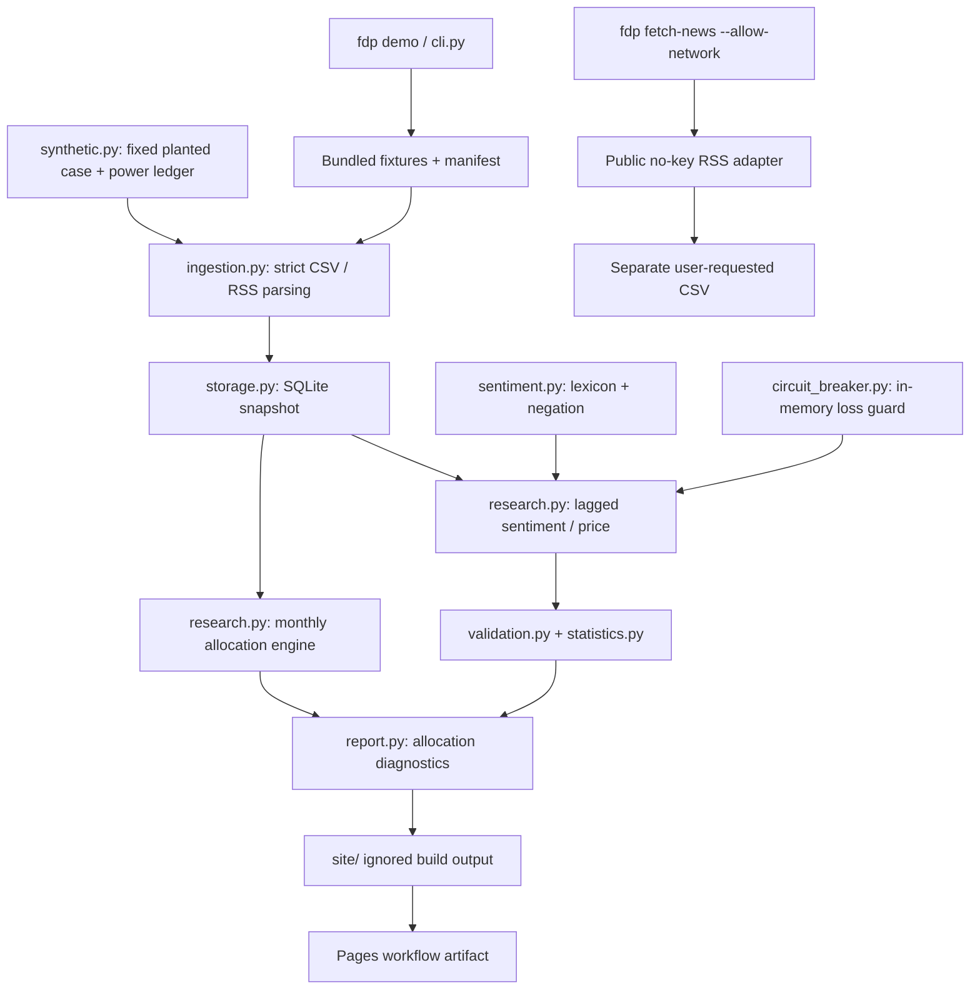

# Architecture

The installable `fdp` package is a synchronous offline research pipeline. It has
no broker or order interface. Every demo run starts from bundled synthetic inputs.

## Boundaries and contracts

- **Ingestion:** rejects invalid schemas, nonfinite/nonpositive prices, duplicate
  price keys, incomplete symbol panels, malformed RSS items and oversized feeds.
  Publication times normalize to UTC. Headline deduplication uses normalized text,
  source, symbol and UTC date. Failure propagates instead of silently skipping rows.
- **Storage:** a SQLite transaction replaces both input tables together. Primary
  keys reject duplicates; readers use read-only connections and deterministic order.
  Demo inputs are read back from storage before either research flow runs.
- **Rebalancer:** long-only fractional-share weights, fixed at 50/40/10 over EQ,
  BOND and GOLD. Rebalances at each month's first observed close. Proportional
  fees are reserved by solving for investable capital before trades are applied.
- **Sentiment flow:** weighted rules score headlines, independent of the ML
  experiments. Prior-calendar-day news determines exposure at today's close;
  that position earns the next interval's return. The loss guard sees completed
  intervals, including their preceding close's cost. Library default has no automatic cooldown/reset. Demo callers explicitly reset
  every five observed sessions; this is exported as `guard_reset` and pauses are shaded.
- **Validation:** applies to the noise and planted sentiment cases only, never
  to allocation returns. Positive compounded return, sign-randomization p-value below
  0.05, deflated Sharpe probability above 0.95 and bootstrap terminal-equity fifth
  percentile above 0.8. All four must pass; invalid inputs raise. Gate failure is
  normal research output and does not fail the demo command. No gate is optional.
- **Report:** Matplotlib's noninteractive backend writes two PNGs. HTML escapes
  dynamic labels and uses inline CSS and local images. JSON rejects nonfinite
  values. CSVs expose per-bar returns, costs, positions and breaker state.
- **Network:** only `fetch-news --allow-network` can invoke the public adapter.
  The demo never uses downloaded content; tests replace sockets with failures.
  Optional adapter tests use fake responses. No credentials or keyed sources.

`site/` contains `index.html`, equity and allocation PNGs, `summary.json`, three
flow CSVs and two SQLite snapshots. The Pages workflow removes both snapshots before
uploading the report artifact. Generated output stays out of Git. CI runs Python
3.11 and 3.12, lint, tests and the demo; Pages deployment uses GitHub Actions as the repository's Pages source.

## Research limits

The original noise fixture is unchanged. A second synthetic control injects
conditional ±10 bp into next-interval simple returns after actionable prior-day
headlines, with independent Gaussian noise SD 60 bp, 5 bp exposure-change costs
and 5,200 sessions. The fixed seed 43 does not pass all gates. The ledger at
`src/fdp/fixtures/detection_power.json` records all outcomes for predeclared seeds
100–119, generated by `scripts/detection_power.py` without parameter tuning.
Twenty runs give only an imprecise empirical detection frequency.

These are synthetic engineering controls, with simplified transaction
costs, end-of-sample mark-to-market and no realistic fill, liquidity, dividend,
tax or exchange-calendar model. It performs no parameter search or training and
makes no out-of-sample strategy claim. Sign randomization assumes symmetry; a
short block bootstrap does not capture all serial dependence. The trial count
is explicitly two for this demo, not a claim about historical research breadth.
Code correctness and statistical gate output are separate from strategy validity.

The original [validation module](../shared/backtest_validation.py),
[methodology notes](VALIDATION.md) and [ML experiments](../ml-experiments/) retain
their existing paths. The packaged subset has documented behavioral corrections;
see [provenance](PROVENANCE.md).
